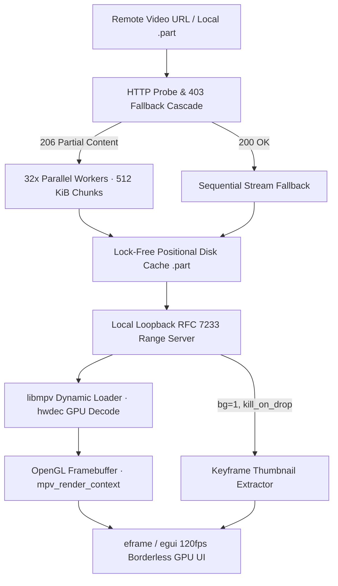

# streamd

Native Rust GPU video player for macOS, Windows, and Linux. Paste a direct link—or drop a local / `.part` / `.crdownload` file—and play immediately on GPU while downloading in parallel. Close the app and all temporary data is gone.

## Architecture



### Core Internals
- **Chunk Engine (`src/engine.rs`)**: Probes with native OS TLS + HTTP/2 and a 5-step `403` fallback cascade. Splits files into `512 KiB` chunks across `32` concurrent workers with an urgent seek priority queue, immediate EOF prefetch (for MP4 `moov` / MKV `Cues`), and lock-free positional I/O (`pread`/`pwrite` on Unix, `seek_read`/`seek_write` on Windows).
- **GPU Video (`src/mpv.rs`)**: Loads `libmpv` dynamically at runtime (`libloading`)—zero C build scripts—and renders hardware-decoded frames (`VideoToolbox` on macOS, `D3D11VA` on Windows, `VAAPI` on Linux) directly into the OpenGL framebuffer with zero remuxing.
- **UI (`src/main.rs`)**: Pure Rust `eframe`/`egui` (`glow`) with custom vector icons, vertex-interpolated fade scrims, headless hairline seekbars (timeline, volume, boost, subtitle delay/speed/size), drag-and-drop local/subtitle support, and free zero-key online subtitle search.
- **Ephemeral Lifecycle**: Exiting the app terminates `mpv`, aborts all workers, and deletes every temporary `.part` and subtitle file.

## Install

Download a self-contained build (includes `libmpv`) from [Releases](../../releases):
- **macOS**: `streamd-macos-arm64.zip` (`streamd.app`)
- **Windows**: `streamd-windows-x64.zip` (`streamd.exe` + `libmpv-2.dll`)
- **Linux**: `streamd-linux-x64.tar.gz` (`streamd` + `libmpv.so.2`)

### Build from Source
```sh
cargo run --release
```

## Shortcuts
`Space`/`K` Play · `←`/`→`/`J`/`L` ±10s · `↑`/`↓` Volume (up to 300%) · `M` Mute · `F` Fullscreen · `C` Subtitles · `0`–`9` Jump 0–90%
